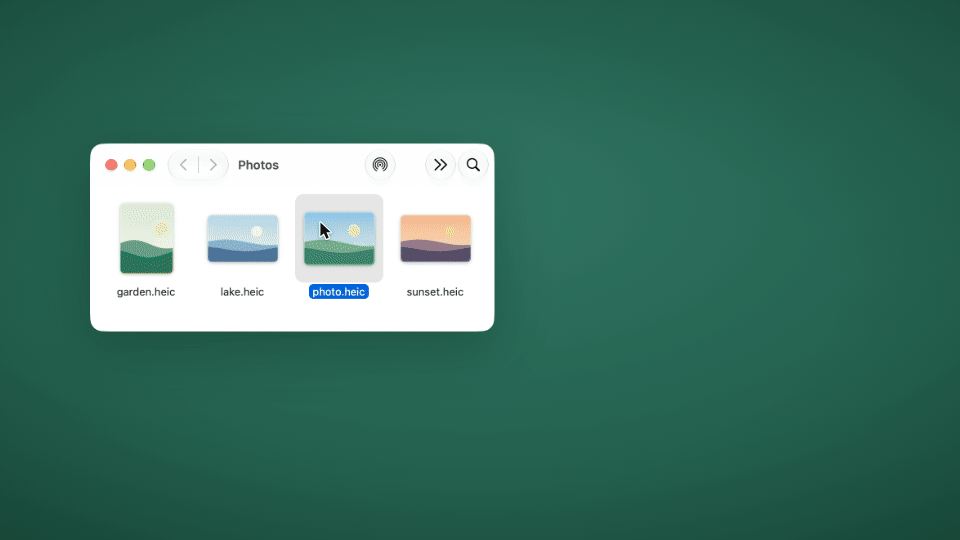

# twistel

**Convert and edit files on your Mac with a ring menu, right where you drag them.**



> Personal project, provided as-is. I may update it occasionally, but there's no schedule and no support.

Drag one or more files in the Finder, hold a key, and a ring appears around the pointer. Drop the files on an option: the result
appears as a new file next to the original. Everything runs on your Mac. Nothing is uploaded, and the app itself never connects to
the internet.

## How it works

Drag files in the Finder and hold a key while dragging:

| Key | Ring | What it offers |
| --- | --- | --- |
| **⇧ Shift** | Convert | the formats the selection can be converted to |
| **⌘ Command** | Tools | e.g. compress, crop, sign a PDF, recognize text |
| **⌃ Control** | Actions | Show in Finder, copy, copy path, pin, move to …, AirDrop, share; under “More …”: checksum, duplicate, open in Terminal |

- Move onto an item and let go. A small pill at the top of the screen shows the progress, then a card offers **Open**, **Show in
  Finder** and **Undo**.
- Switch rings while dragging by holding another key. Letting go outside the ring cancels.
- The last item, “More …”, lists everything that works for the file, with a search field.
- Tools with settings open a small window that remembers your last values; Return starts. Hold **⌥ Option** as well when you let go
  to run the tool straight away with the last values.
- Keys, ring items (favorites per file type) and their order can be changed in Settings.

Without dragging: **Choose Files …** in the menu bar icon’s menu, or right-click files in the Finder and pick **Convert with
twistel**, **Tools in twistel** or **Actions in twistel** at the very bottom (with many services installed, under *Services* or
*Quick Actions*).

The app lives in the menu bar and has no Dock icon. It needs neither *Accessibility* nor *Input Monitoring* permission.

The interface is in English and German. It follows the system language (German on a Mac set to German, English otherwise) and
can be switched in Settings › General.

## Features

### Convert

303 conversions between these formats:

| Kind | Formats |
| --- | --- |
| Images | JPG, PNG, WebP, HEIC, TIFF, SVG (read only), AVIF, BMP, to PDF |
| Audio | MP3, M4A, WAV, FLAC, OGG, Opus, AIFF, WMA |
| Video | MP4, MOV, MKV, WebM, AVI, WMV, GIF, audio track as MP3 |
| Documents | PDF, DOCX, DOC, ODT, RTF, RTFD (read), text clipping (read), HTML, Markdown, TXT, EPUB |
| Spreadsheets | XLSX, XLS, ODS, CSV, TSV |
| Presentations | PPTX, PPT, ODP |
| Subtitles | SRT, VTT |
| Archives | ZIP, TAR, GZIP, RAR (read only) |

Converting a PDF to Word, Markdown, EPUB or Excel recognizes the page layout (headings, lists, tables, columns, highlighter marks)
and reads scanned pages with text recognition.

### Tools

41 tools, among them:

- Any file: compress, edit metadata
- Images: edit photo, add background, crop, redact, resize, rotate and flip, combine into a PDF, collage, social media &
  sharing presets, cut out subject
- Images and PDFs: recognize text (OCR), read QR codes, annotate
- Video: trim, crop, change speed, join, save frames, split, redact, social media presets, burn in subtitles
- Audio: normalize loudness, visualize, trim, channels, bleep out
- Audio and video: transcribe (text, SRT, VTT) with whisper.cpp
- PDF: merge, reorder pages, split, extract images, password, watermark, page numbers, archive as PDF/A, redact (with a check
  afterwards), sign, compare

## Requirements

- macOS 26 (Tahoe) or later.
- A Mac with Apple silicon (M1 or later). The app is built for Apple silicon only; Intel Macs are not supported.
- Optional: free helper programs from Homebrew for some formats and tools (see below).

## Installation

1. Download `twistel-1.0.0.dmg` from the [Releases page](https://github.com/jonasnlt/twistel/releases).
2. Open the DMG and drag **twistel** onto **Applications**. Start it from there: the Finder’s
   right-click entries only appear for the copy in Applications.
3. First start (“Open Anyway”): the app is not notarized by Apple (that needs a paid developer account), so macOS warns the first
   time: *“twistel” Not Opened. Apple could not verify “twistel” is free of malware …*. Click **Done** (not *Move to Trash*), then
   open **System Settings › Privacy & Security**, scroll down to **Security** and click **Open Anyway** next to the note about
   twistel. Confirm with your password or Touch ID and choose **Open Anyway** once more. From then on twistel opens normally.

An icon appears in the menu bar, and the introduction opens on the first start. The checksums of the download are in
`SHA256SUMS.txt` on the Releases page. A step-by-step guide (permissions, the speech model, uninstalling) is in
[docs/INSTALLATION.md](docs/INSTALLATION.md).

There is no automatic update check; **Check for Updates …** in the menu bar icon’s menu opens the Releases page in your
browser.

### Optional helper programs

Much of the work is done with Apple’s own frameworks (ImageIO, PDFKit, AVFoundation, Vision). For the rest, twistel calls free
programs if you have installed them. None of them is built into or shipped with the app. If one is missing, twistel tells you where
it is needed and how to install it. Install [Homebrew](https://brew.sh), then:

| Command | What for | Without it |
| --- | --- | --- |
| `brew install ffmpeg` | audio and video beyond Apple’s formats (writing MP3, FLAC, OGG, Opus, WMA, MKV, WebM, AVI, WMV, GIF, WebP, AVIF), loudness, audio visualizer, audio for transcription | these conversions and tools say that ffmpeg is missing |
| `brew install --cask libreoffice` | Word, Excel, PowerPoint and OpenDocument with their real layout; DOC, XLS, PPT, ODS, ODP | Word, RTF and HTML go through Apple’s simpler text system (no headers, some images and tables lost); spreadsheets and presentations are not available |
| `brew install ghostscript` | strong PDF compression (text stays selectable), PDF/A | compression with Apple’s simpler method; no PDF/A |
| `brew install qpdf` | set and remove PDF passwords (AES-256) | *PDF password* is not available |
| `brew install whisper-cpp` | transcription and subtitles from speech (also needs a speech model, see [docs/INSTALLATION.md](docs/INSTALLATION.md#6-speech-model-for-transcription-whispercpp)) | *Transcribe* is not available |
| `brew install poppler` | an additional check after redacting a PDF | the check runs without this one reader |
| `brew install unar` | open RAR archives | RAR only if macOS’s built-in `tar` can open it, otherwise a note |

## Privacy

- No network access: twistel has no telemetry, no analytics, no update check and no online features. It never connects anywhere
  itself; *Check for Updates …* and the link in the About window only hand an address to your browser.
- Helper programs run without internet: twistel starts every helper program inside a macOS sandbox (`sandbox-exec`) that blocks
  all network access, including name lookups (DNS). If that lock does not work on a Mac, twistel does not start the program at all
  and says so, instead of running it unprotected.
- Your originals stay untouched: results are written to a temporary folder and only moved next to the original at the end. After
  an error, a cancellation or a full disk, no half-written file is left behind.
- Programs are never started through a shell with file names in the command.
- Log: `~/Library/Logs/twistel/twistel.log` contains file names (without the folders they are in) and steps, never passwords or
  file contents. PDF signatures are stored in this Mac’s keychain only, not in iCloud.

## Known limitations

- Not notarized: macOS asks you to confirm the first start (see *Installation*). After rebuilding twistel yourself, macOS may ask
  once more before it reads saved signatures from the keychain.
- HDR video becomes SDR when converted, on purpose, so the result looks the same and plays everywhere.
- HDR images are processed with 8 bits per channel. They keep their color space, but smooth gradients can show banding. *Edit
  metadata* does not touch the pixels and keeps the HDR gain map of iPhone photos.
- *Cut out subject* uses Apple’s subject detection; very fine hair can lose single strands.
- Office files look best with LibreOffice installed; without it, Apple’s text system loses headers and some images and tables.
- Transcription needs whisper.cpp and a speech model of 1.6 to 3.1 GB; a Mac with 8 GB of memory should use the smaller model.
- Pages, Numbers and Keynote files are not supported.
- Tested on macOS 27 so far; macOS 26 is the minimum the app is built for.

## Building it yourself

The Command Line Tools are enough; Xcode is not needed.

```bash
xcode-select --install          # once, if the Command Line Tools are missing
./scripts/build.sh              # debug build: ".build/debug/twistel dev.app"
./scripts/build.sh --release    # release build: .build/release/twistel.app
./scripts/release.sh            # finished version in dist/: app, ZIP, DMG, checksums
```

The scripts use the macOS 26.5 SDK of the Command Line Tools (`SDKROOT=/Library/Developer/CommandLineTools/SDKs/MacOSX26.5.sdk`;
another SDK can be set with `SDKROOT`). The app icon is prebuilt in `Resources/`; only `scripts/icon.sh` needs Xcode, to rebuild it
from `Icon/AppIcon.icon`.

The debug build is called twistel dev (bundle ID `io.github.jonasnlt.twistel.debug`, “DEV” badge on the icon, no Finder
services unless built with `TWISTEL_DEV_SERVICES=1`); the release build is twistel (`io.github.jonasnlt.twistel`). They keep
separate settings, and only one of them runs at a time. `scripts/release.sh` checks the signature, the hardened runtime and that
the release build contains no debug parts.

Layout of the source code:

```
Sources/App         start, menu bar, settings, test access
Sources/Core        jobs and progress, helper programs, time limits, log, error messages
Sources/Formats     formats and conversion routes
Sources/Engines     converting: image, audio, video, document, office, subtitles, archive
Sources/Operations  what is behind the tools
Sources/Radial      detecting drags and the ring menu
Sources/Tools       tool windows
Sources/UI          colors and shapes
```

## License

Copyright (C) 2026 jonasnlt

This program is free software: you can redistribute it and/or modify it under the terms of the GNU General Public License as published
by the Free Software Foundation, version 3 ([GPL-3.0](LICENSE)). It is distributed in the hope that it will be useful, but WITHOUT
ANY WARRANTY; without even the implied warranty of MERCHANTABILITY or FITNESS FOR A PARTICULAR PURPOSE. See the [LICENSE](LICENSE)
file for details.

The app contains code from [Satsuma](https://github.com/plyght/satsuma) by plyght under the MIT License; its notice is kept in
[LICENSES/Satsuma-MIT.txt](LICENSES/Satsuma-MIT.txt). The helper programs are separate programs with their own licenses and are not
part of twistel; see [THIRD-PARTY.md](THIRD-PARTY.md).

## Contributing

Issues are open, but I may not respond or fix anything. Pull requests are not accepted. Please report security problems
privately (see [SECURITY.md](SECURITY.md)).

## Acknowledgments

- Based on [Satsuma](https://github.com/plyght/satsuma) by plyght (MIT License).
- Thanks to the people behind FFmpeg, LibreOffice, Ghostscript, qpdf, whisper.cpp, Poppler and The Unarchiver.

## Deutsch

Mit der kostenlosen Mac-App twistel lassen sich Dateien umwandeln und bearbeiten: Datei im Finder ziehen, dabei eine Taste halten
und im Ringmenü auf eine Option fallen lassen. Das Ergebnis liegt als neue Datei neben dem Original, alles bleibt auf dem Mac. Die
Oberfläche gibt es auf Deutsch und Englisch. Installation: siehe [docs/INSTALLATION.md](docs/INSTALLATION.md) (Englisch).
